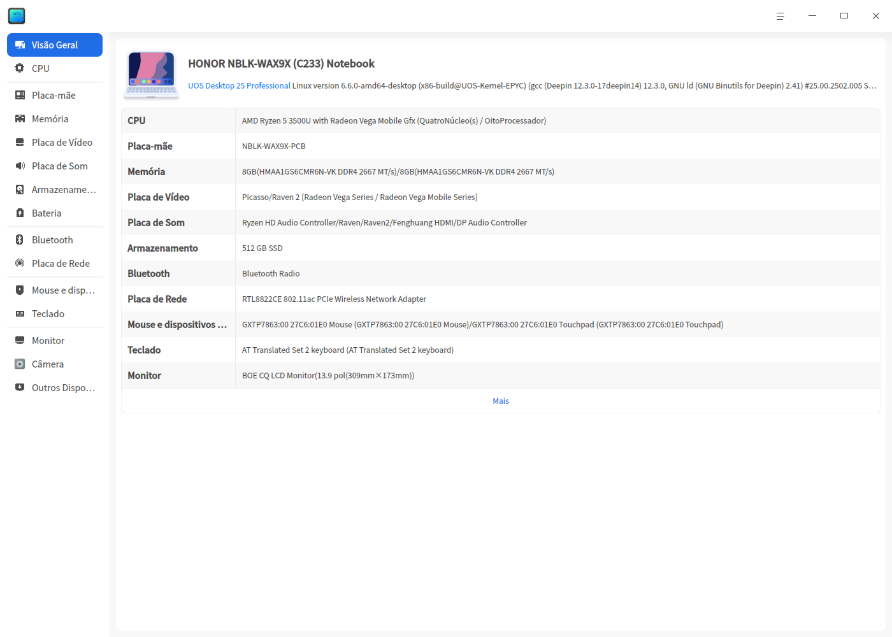
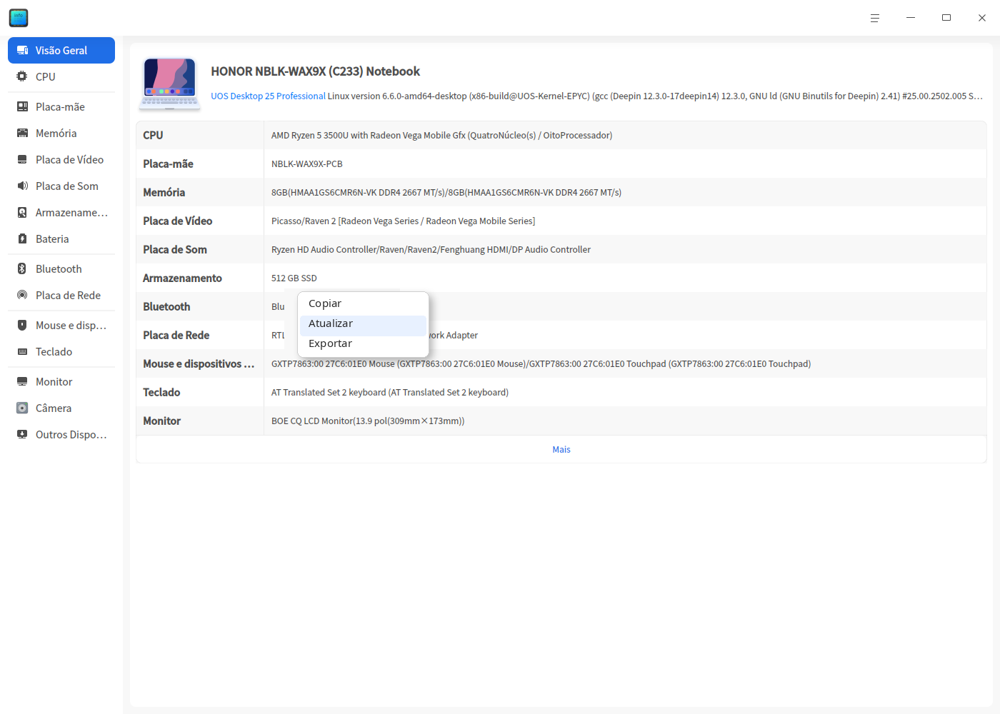
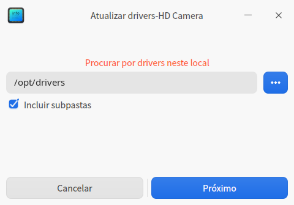
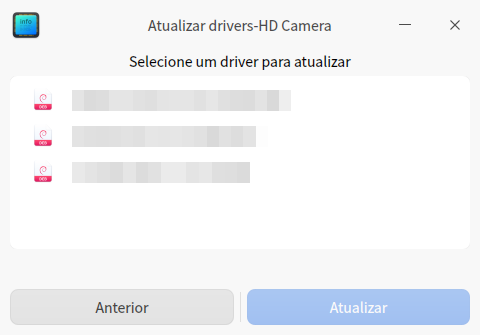

# Gerenciador de dispositivos|deepin-devicemanager|

## Visão geral

O Gerenciador de dispositivos é uma ferramenta para consultar e gerenciar dispositivos de hardware. Ele mostra as informações dos dispositivos de hardware em operação no sistema e permite gerenciar drivers.

## Primeiros passos

Você pode iniciar o Gerenciador de dispositivos, fechá-lo ou criar um atalho das seguintes formas.

### Iniciar o Gerenciador de dispositivos

1. Clique no ícone do iniciador na barra de tarefas  para abrir a interface do iniciador.

2. Role a roda do mouse para cima ou para baixo ou use a busca para localizar o ícone do Gerenciador de dispositivos  e clique nele para iniciar.

3. Clique com o botão direito em  para:

   - Clicar em **Enviar para a área de trabalho** e criar um atalho na área de trabalho.

   - Clicar em **Enviar para a barra de tarefas** e fixar o aplicativo na barra de tarefas.

   - Clicar em **Iniciar automaticamente ao ligar** e adicionar o aplicativo aos itens de inicialização, para que ele seja executado automaticamente ao ligar o computador.

### Fechar o Gerenciador de dispositivos

- Na interface do Gerenciador de dispositivos, clique em  para sair.
- Na barra de tarefas, clique com o botão direito em  e selecione **Fechar tudo** para sair.
- Na interface do Gerenciador de dispositivos, clique em  e selecione **Sair** para sair.

## Informações de hardware
As informações exibidas pelo Gerenciador de dispositivos estão relacionadas ao hardware do computador. Se você conectar dispositivos como mouse e teclado, as informações correspondentes serão exibidas. Se forem detectados vários dispositivos do mesmo tipo, as informações aparecem em forma de lista.

### Informações do dispositivo

Na interface do Gerenciador de dispositivos, clique em **Informações de hardware** para consultar os detalhes do hardware em operação no sistema.

A tabela abaixo apresenta os itens de hardware mais comuns e serve apenas como referência; considere a situação real do seu computador.

<table class="block1">
    <caption></caption>
    <tbody>
        <tr>
            <td width="150px"><b>Nome do hardware</b></td>
            <td><b>Informações do hardware</b></td>
        </tr>
        <tr>
            <td>Visão geral</td>
            <td>Exibe as informações do kernel do sistema e a lista de dispositivos de hardware.</td>
        </tr>
        <tr>
            <td>Processador</td>
            <td>Exibe o nome, o fabricante, o tipo de processador e a arquitetura.</td>
        </tr>
        <tr>
            <td>Placa-mãe</td>
            <td>Exibe o fabricante, a versão, o chipset e a versão do SMBIOS da placa-mãe.</td>
        </tr>
         <tr>
            <td>Memória</td>
            <td>Exibe o nome, o fabricante, o tamanho, o tipo e a velocidade da memória.</td>
      </tr>
      <tr>
            <td>Adaptador de vídeo</td>
            <td>Exibe o nome, o fabricante e o modelo do adaptador de vídeo.</td>
        </tr>
       <tr>
            <td>Adaptador de áudio</td>
            <td>Exibe o nome, o fabricante e o modelo do adaptador de áudio.</td>
        </tr>
         <tr>
            <td>Dispositivo de armazenamento</td>
            <td>Exibe o modelo, o fabricante e o tipo de mídia do dispositivo de armazenamento.</td>
        </tr>
        <tr>
            <td>Adaptador de rede</td>
            <td>Exibe o nome, o fabricante, o tipo e o driver do adaptador de rede.</td>
        </tr>
         <tr>
            <td>Mouse</td>
            <td>Exibe o nome, o fabricante, o modelo e a interface do mouse.</td>
        </tr>
          <tr>
            <td>Teclado</td>
            <td>Exibe o nome, o modelo, o fabricante e a interface do teclado.</td>
        </tr>
        <tr>
            <td>Dispositivo de exibição</td>
            <td>Exibe o nome, o fabricante, o tipo e o tipo de interface do dispositivo de exibição.</td>
        </tr>
   </tbody>
   </table>

### Menu de contexto

Na área de detalhes do dispositivo, clique com o botão direito para acessar as operações disponíveis.

#### Copiar

Copia todas as informações da página atual. Para as informações que podem ser selecionadas, também é possível copiar apenas uma parte.

#### Atualizar

Recarrega as informações de todos os dispositivos atuais do sistema. O atalho é **F5**.

#### Exportar

Exporta as informações do dispositivo para a pasta indicada; os formatos suportados são txt/docx/xls/html.

#### Desativar/Ativar

Alguns drivers de hardware oferecem as funções de desativar e ativar. Por padrão, o driver está ativado; verifique no menu de contexto se a função de desativar está disponível.

#### Atualizar driver

Alguns hardwares oferecem as funções de atualizar e desinstalar o driver; verifique no menu de contexto se elas estão disponíveis.

1. No menu de contexto, selecione **Atualizar driver** para abrir a janela.

2. Selecione a pasta em que o driver está e clique em **Próximo**. A opção "Incluir subpastas" vem marcada por padrão, o que faz o sistema verificar os arquivos de driver da pasta e das suas subpastas.

   

3. O sistema verifica todos os arquivos de driver instaláveis nos formatos deb e ko presentes no local indicado. Selecione o arquivo de driver correspondente e clique em **Atualizar**.

   

4. A janela de autenticação é exibida; digite a senha de login do sistema para autenticar e concluir a atualização.

5. Se a atualização falhar, o sistema reverte automaticamente o driver do dispositivo para a versão anterior, sem prejuízo ao uso. Recomenda-se verificar a causa da falha conforme as mensagens do sistema e repetir a atualização.

#### Desinstalar driver

Para dispositivos que você não quer mais usar, é possível desinstalar o driver.

1. No menu de contexto, selecione **Desinstalar driver** e, após a confirmação, clique em **Desinstalar**.

   - Desinstalação bem-sucedida: o dispositivo passa ao estado de indisponível.

   - Falha na desinstalação: o driver original continua funcionando normalmente; recomenda-se verificar a causa da falha conforme as mensagens do sistema e repetir a desinstalação.

2. Se quiser voltar a usar o dispositivo, clique com o botão direito na página de detalhes do dispositivo e selecione **Atualizar driver** para instalar o driver.

#### Ativar o computador

Quando o computador está em suspensão, é possível ativá-lo e acender a tela pelo mouse, pelo teclado e pela placa de rede. Se o dispositivo estiver desativado, essa função não estará disponível.

**Ativar o computador pelo mouse e pelo teclado**

1. Na interface de informações de hardware, clique em **Mouse** ou **Teclado** para exibir os detalhes do dispositivo.

2. Na área de detalhes, clique com o botão direito para marcar ou desmarcar **Permitir ativar o computador**.

   - Permitir ativar o computador: com o computador em suspensão, um clique esquerdo, um clique direito, um clique do botão do meio do mouse ou qualquer tecla do teclado ativa o computador e acende a tela.

   - Não permitir ativar o computador: com o computador em suspensão, os cliques do mouse ou as teclas do teclado não produzem resposta.

**Ativar o computador pela placa de rede**

1. Na interface de informações de hardware, clique em **Adaptador de rede** para exibir os detalhes do dispositivo.

2. Na área de detalhes, clique com o botão direito para marcar ou desmarcar **Permitir ativar o computador**.

   - Permitir ativar o computador: com este computador em suspensão, outro computador (na mesma sub-rede, ou seja, cujo IP possa ser alcançado por ping) pode enviar um pacote de rede especial (comando Wake On LAN) e ativar este computador, acendendo a tela.

   - Não permitir ativar o computador: com o computador em suspensão, o envio do pacote de rede especial (comando Wake On LAN) por outro computador (na mesma sub-rede, ou seja, cujo IP possa ser alcançado por ping) não produz resposta.

## Menu principal

No menu principal, você pode alternar o tema da janela e consultar o manual de ajuda, entre outras operações.

### Tema

O tema da janela inclui tema claro, tema escuro e tema do sistema.

1. Na interface do Gerenciador de dispositivos, clique em .
2. Clique em **Tema** e escolha uma cor de tema.

### Ajuda

1. Na interface do Gerenciador de dispositivos, clique em .
2. Clique em **Ajuda** para consultar o manual e conhecer melhor o Gerenciador de dispositivos.

### Sobre

1. Na interface do Gerenciador de dispositivos, clique em .
2. Clique em **Sobre** para ver a versão e a descrição do Gerenciador de dispositivos.

### Sair

1. Na interface do Gerenciador de dispositivos, clique em .
2. Clique em **Sair**.
